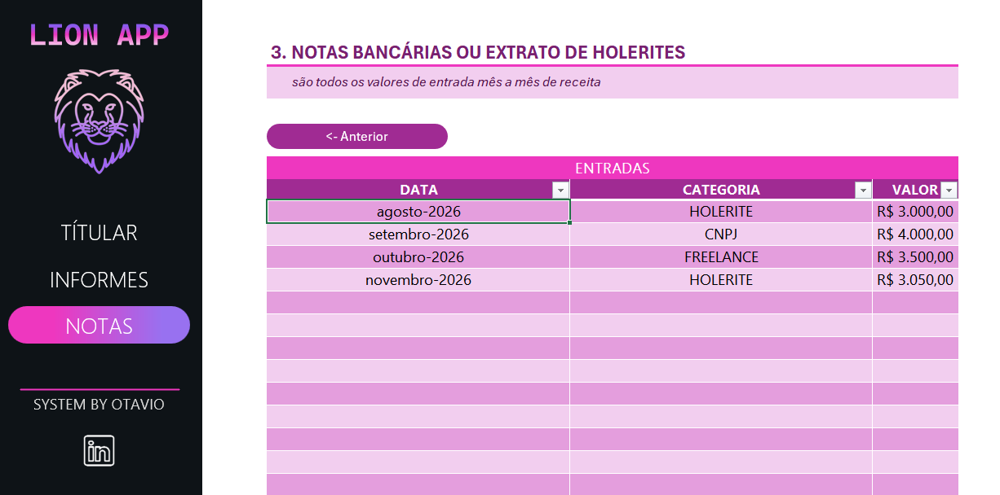

# Facilitador de Imposto de Renda
Uma ferramenta em Excel para auxiliar a reunir informações importantes para a declaração do imposto de renda de forma organizada.
A ferramenta conta com um visual interativo e simples de se utilizar entre suas três áreas

# 🧩 Funcionalidades

- Permite a inserção de dados do titular como nome, CPF, data de nascimento e etc...
- Permite inserir dados relacionados com as contas bancárias vinculadas ao titular e mostra o valor somado de todas juntas
- Disponibiliza uma tabela para informar todos os valores de entrada de receita por mês entre algumas categorias definidas como: 
**Holerite**, **CNPJ** e **Freelance**

# 🖼️ Images do Projeto

